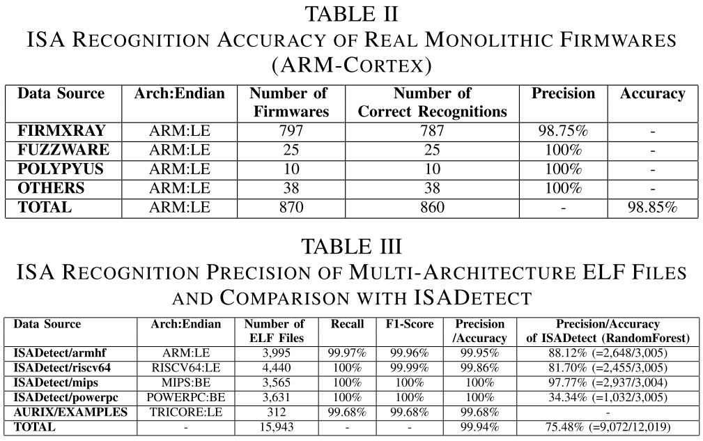

# FBFISADetector (Filter Based Firmware ISA Detector)
**<font color="red">主要目标：</font>** 识别单机固件（Monolithic Firmware）的**指令集架构（包含字节序）**  
**<font color="red">MAIN PURPOSE:</font>** Identify **the ISA (Instrunction Set Architecture) and Endianness** of Monolithic Firmware

## 前期配置
**下载项目：**  
```bash
git clone --recursive https://github.com/NCNIPCIoTSec/FBFISADetector.git
# git submodule update --init --recursive
```  

**下载虚拟环境：** 使用的Python的virtualenv库（[环境配置参考链接](https://blog.csdn.net/littlefun591/article/details/135740075)）  
  ```shell
  pip install virtualenv virtualenvwrapper
  mkdir ~/.virtualenvs
  sudo find / -name virtualenvwrapper.sh
  ```
`vim ~/.bashrc` **修改~/.bashrc**
  ```shell
  export VIRTUALENVWRAPPER_PYTHON=/usr/local/bin/python3
  export WORKON_HOME=$HOME/.virtualenvs
  export VIRTUALENVWRAPPER_VIRTUALENV=$HOME/.local/bin/virtualenv
  source ~/.local/bin/virtualenvwrapper.sh
  ```
**创建虚拟环境并进入**  
  ```shell
  # 本实验使用的Python版本为3.11.11  
  mkvirtualenv FBFISADetector --python=$(which python)
  workon FBFISADetector
  pip install --upgrade pip
  ```
**下载项目并下载依赖的库**  
  - **可python pip 直接下载的有：** sympy, pyelftools, numpy, matplotlib, angr, capstone, pyghidra, ghidra-stubs==\<your-ghidra-version\>
  - **需要github上自行下载的有：** pypcode, python-javabridge, *capstone  
  ```bash
  cd FBFISADetector 
  pip install -r requirements.txt
  # pypcode                 3.2.2.dev0
  cd requirements/pypcode && python setup.py install
  cd ../python-javabridge && pip install -e .
  cd ../ghidra/
  # 编译 ghidra
  # 请先确认java版本、Gradle版本、Python版本是否与项目要求一致
  # 如果java版本有问题，在~/.gradle/gradle.properties中指定java安装路径
  # org.gradle.java.home=/your/jdk/path/jdk-21.0.10+7/
  # Maven仓库：echo "/your/maven/repository" > /your/ghidra/path/ghidra.repos.config
  gradle -I gradle/support/fetchDependencies.gradle
  gradle buildGhidra
  ./gradlew prepDev
  # （不建议）按需下载，最新版的capstone会支持更多的架构，但是与pip下载的angr不兼容；因此，本次实验主要依赖逆向引擎-Ghidra-from pypcode
  # cd ..
  # git clone https://github.com/capstone-engine/capstone.git
  # cd capstone/bindings/python && python setup.py install
  # 安装unicorn仿真器
  cd ../unicorn/bindings/python && python setup.py install && cd ../../../../
  ```

## 运行

测试单个二进制文件
```shell
cd src
python detectisa.py -f <path/to/binary> # 不开启多进程测试二进制文件
python detectisa.py -p -f <path/to/binary> # 开启多进程测试二进制文件
python detectisa.py -p -a <arch> -f <path/to/binary> # 开启多进程测试二进制文件，并且仅测试制定ISA架构
```
未完善批量测试二进制文件功能，目前方法参考 `src/main.py`；
```shell
python main.py
```
注意：

```python
# <setting.py>
# 获取所有架构的**配置文件路径**信息
ARCH_INFO = dict()
for arch_file in os.listdir(CONFIG_DIR+'arch/'):
    arch = arch_file.replace(".json", "")
    ARCH_INFO[arch] = CONFIG_DIR+'arch/'+arch_file

# 初始化分析器 - 静态函数
BinaryAnalyzer.updateSupportedArch(supported_arch_info=ARCH_INFO)
BinaryAnalyzer.loadBrachCalculationExpressions(branch_calc_info_path=CONFIG_DIR+"call_branch.json")

# <main.py>
# 开启多进程分析，不调用此函数则默认单进程，分析速度会慢很多 - 静态函数
BinaryAnalyzer.openMultiProcessing() 

# 测试二进制文件示例
bin_file_path = "<path/to/binary>"
ba = BinaryAnalyzer(bin_file_path=bin_file_path)
ba.analyzing()
```
## 打包成库
运行主目录中的 `setup.py` 打包成库
```shell
python -m pip install .
```

## 嵌入式单机固件的指令集架构识别的意义
- 主要意义：
  - **降低识别成本**。无需再依据产品型号、硬件型号手动搜索MCU使用的指令集架构；  
  - **大规模自动化固件分析**。信息收集作为固件分析的重要阶段之一，往往涉及大量的人力成本去进行指令集架构分析、固件Flash基地址分析、程序入口点分析，这些分析获取的内容对于接下来的静态、动态分析挖掘程序漏洞都是必要的。一个完善的自动化识别工具能够大大提高固件分析效率；  
- 其他极端场景：
  - 硬件缺失或者硬件识别信息磨损的环境下，固件的信息收集需要额外的工作；
  - 不可/难以拆卸的嵌入式设备的固件调试；
  - 固件烧录前的黑盒测试 / 其他方式获取固件，如一些侧信道方法获取等非法或合法手段；

## 相关工作
- 【 Binwalk 二进制识别工具】解包含系统的路由器固件

  - CCFA NDSS'17 - [Firmdyne](https://www.ndss-symposium.org/wp-content/uploads/2017/09/towards-automated-dynamic-analysis-linux-based-embedded-firmware.pdf)
  - CCFB ACSAC'20 - [FirmAE](https://dl.acm.org/doi/abs/10.1145/3427228.3427294)
  - CCFA S&P'21 - [Enabling the Large-Scale Emulation of Internet of Things Firmware With Heuristic Workarounds](https://ieeexplore.ieee.org/abstract/document/9431371)
- 【机器学习方法】对*nix系统仓库的二进制可执行文件进行ISA识别
  - **CCFC DFRWS'15 - [Automatic classification of object code using machine learning](https://www.sciencedirect.com/science/article/pii/S1742287615000523)**  
  <font color="red">首次提出基于机器学习方法的指令集架构（Instructions Set Architecture, ISA）识别。</font>基于 **“字节值直方图（byte-value histograms）”** 来保存操作码（opcode）密度（ $Opcode\_Density = \dfrac{length\_of\_opcode}{average\_instruction\_length}$ ），基于特殊双字节值 **0x0001和0xfffe** 来判断目标指令集架构的字节序，以{value-0, ..., value-255, count-0x0001, count-0x0100, count-0xfffe, count-0xfeff}这种260维向量的形式表示二进制文件的内容特征。   
  **缺点：** 在嵌入式固件环境中，大量的数据表并不是会对字节频率的特征产生混淆；并且，在指令中，操作数（Operand）种存在的立即数或者寄存器标识，在字节的维度上，仍然会对字节频率分析的方法带来很大干扰。  
  - **CCFC DIMVA'18 - [ELISA: ELiciting ISA of Raw Binaries for Fine-Grained Code and Data Separation](https://link.springer.com/chapter/10.1007/978-3-319-93411-2_16)**  
  **主要完成了两项工作：** ISA识别、“代码与数据段”的区分。  
  **其ISA识别的工作** 是在[Clemens](https://www.sciencedirect.com/science/article/pii/S1742287615000523)的工作基础之上，增添了对常见架构的函数前置、后端字节的模式匹配（the patterns of **known function prologues and epilogues** from the archinfo project part of angr），以 $f_{pattern} = \dfrac{\text{num  of match(pattern, file)}}{len(file)}$ 作为特征向量中的一个值，增强模型对架构特征的识别能力。  
  **注：** archinfo中的known function prologues and epilogues在angr项目中的主要目的是对函数边界的识别，使得逆向分析器可以更精确地构建控制流图(Control Flow Graphic，CFG)。  
  **缺点：** 虽然ELISA使用了模式匹配来统计架构种函数体的前置、后端字节在文件中的比例，但是，除了数据表带来的干扰效果外，当模式识别的识别的位置处于操作数（operand）上时，这种错位也会产生误识别。此外，这类方法虽然关注到了函数体，但是，仍然没有对函数内指令间的语义特征实施更多的关注，仍然停留在频率分析上，这导致操作数/数据表对整体结果的影响仍然很大。    
  - **ACM CODASPY'20 - [ISAdetect: Usable Automated Detection of CPU Architecture and Endianness for Executable Binary Files and Object Code](https://dl.acm.org/doi/10.1145/3374664.3375742)**  
  解决了ISA识别领域缺乏[**开源数据集**](https://etsin.fairdata.fi/dataset/80fa69af-addb-4f9a-b45c-c16011bae366)的问题，此外，他还提供了一些开源的机器学习API，方便对之前的前沿工作进行重现。  
  - **JournalA IEEE TIFS'23 - [A Natural Language Processing Approach for Instruction Set Architecture Identification](https://ieeexplore.ieee.org/document/10159173)**    
  <font color="red">首次提出更 **细粒度** 的特征抽取方法</font>，基于(1,2)-gram TF-IDF对二进制文件中的字节频率信息进行抽取，其中，他们还使用NLP领域的逆向文档频率（Inverse Document Frequency）。  
  根据下面三个算式可以了解到，基于TF-IDF的方法能够削弱无意义字节对识别的影响，例如固件刷写后存在的大量0xff或0x00字节。本文作者对字节频率的统计使用了1-gram TF-IDF方法对值为0-255的字节频率进行向量化，他们认为1字节的统计方法能尽可能地保留opcode信息且有更好地兼容性（由于不同架构的指令长度不同）。他们还是用了2-gram TF-IDF的方法进行字节序的识别，因为他们认为字节序可以通过两字节就能够进行判断，如0x0001->0x0100、0xfffe->0xfeff。他们还在使用3-gram在特征向量尾部添加了5000个常见的3字节模式，增强架构特征。此外，由于opcode的大小通常小于1字节，所以他们认为基于字节的分析方法并不能即将opcode特征更好地识别出来，所以，他们采用了字符级（character-level）的分析方法，即，将二进制内容每个字节进行base-16、32、64、85编码，使得字节转成字符，使得每个字符拟合更多的位信息。此方法还能降低向量长度，增强分析效率。  
  **缺点：** Base编码放大位特征是个很好的思路，但是，根据其实验发现Base-85与Base-32的聚类效果并不好，这里我们猜测：由于指令长度大都是小于等于4字节（32位），Base-85和Base-32则分别是将4字节转5字符、5字节转8字符，而1. 将一条指令变成多指令间的重组，可能会将位信息扰乱；2. 当编码后一个字符能容纳位信息比例越小，所产生的噪声信息就越大。  
$$TF(τ) = \dfrac{\text{num of times τ appeared in the document}}{\text{num of terms in the document}}, \text{τ is target term of document}; \\
\text{IDF}(τ) = log(\dfrac{\text{num of documents in the corpus} + 1}{\text{num of documents with τ} + 1}) + 1; \\ 
\text{TF-IDF}(τ) = TF(τ) × \text{IDF}(τ)$$   

  -  **（中国期刊）计算机科学学报'24 - [基于函数调用指令特征分析的固件指令集架构识别方法](https://doi.org/10.11896/jsjkx.230500087)**  
  提出了一种基于函数调用指令特征分析的固件指令集架构识别方法，通过同时利用指令中操作码和操作数所包含的信息识别目标固件中的函数调用指令，将其作为关键特征实现对不同指令集架构的分类，并基于该方法开发了原型系统 **EDFIR(Embedded Device Firmware Instruction set Recognizer)**。他们使用模式识别模糊定位可能的函数调用指令，并将这些指令分为“跳转地址与PC相关以及无关“两类。PC相关指的是operands包含的信息为相对（PC的）偏移量，即， $EA_{pc} = [PC] + offset$ ；无关则是其偏移量与基地址相关， $EA_{ba} = BaseAddress + offset$ ，但<font color = "red">并未考虑寄存器寻址</font>等。  
  **A. 函数调用指令的筛选。** 对于函数调用指令，他们仍然采用高频指令（如，数据存储相关，mov/ld/str等）进行判别：目标地址后的X个字节内，是否存在这些高频指令，其中，X为自定义阈值。然而，在真实固件识别任务中，实际上基地址往往难以确定，所以对于 $EA_{ba}$ ，EDFIR选择不进行计算跳转，而是选择检查跳转指令K近邻的关键指令并分析它们的数量是否大于自定义阈值N，再利用跳转范围的统计学特征进行判定。 **B. 架构判定。** 计算分数方式，PC相关： $Score = (Arch_{vcnt} / Arch_{rcnt}) * Arch_{vent}$，其中， $Score$ 为该架构的函数调用数量积分， $Arch_{rcnt}$ 为该架构的疑似函数调用指令数量， $Arch_{vcnt}$ 为该架构经过认证的函数调用指令数量。PC无关： $Score = (Arch_{vcnt} / Arch_{rcnt}) * Arch_{vent} * Arch_{validrange}$， $Arch_{validrange}$ 为该架构函数调用指令的有“效范围比例”。根据积分的高低进行投票，将最高积分对应的指令集架构视为目标的指令集架构。    
  **缺点：** 仍然没有跳脱频率分析的范畴，自定义的阈值和统计学特征使得方法的识别准确率存在较大的偏差。如果将跳转信息作为强特征信息，作为向量输入结合机器学习、深度学习方法会不会更好。

## 挑战  
先前的研究工作存在的问题（总结）：  
- **首先，是前沿工作存在的问题：** 目前的前沿工作集中在如何将二进制文件更好地量化，转化为特征向量，传送到机器学习的分类模型中去。他们的方法：A.都关注在opcode在出现的频率，但是仍以字节的角度分析，**忽略了opcode与operand间的关系**，即使[*Sahabandu*](https://ieeexplore.ieee.org/document/10159173)的工作关注到了此类问题，但是Base编码的方法只能放大位特征，但无法消去operand对opcode的影响。在嵌入式领域，对固件二进制内容进行编码，开始编码的起始位置也是非常注意的问题。B.**对特定架构指令内容的语义信息关注较少（如，指令间关系、指令内容与MMIO使用的逻辑关系）。** 虽然[*ELISA*](https://link.springer.com/chapter/10.1007/978-3-319-93411-2_16)考虑到了函数体前置、后端处的指令模式信息，但是并没有进行深度分析与使用。     
- **为什么不用机器学习？概率模型（频率分析的方法）因为是黑盒，具有不可解释性，识别准确率仍存在很大改进空间。** 尤其是对于一些传统的分类模型，存在明显的数据先验知识依赖的情况，固件场景是比较复杂的，其数据内容不仅有。再者，概率模型方法的灵活性性、可扩展性有限。当引入一个新的架构，模型的重新很耗时是一个方面，还有就是添加一个新架构后，模型效果可能存在极大的变化。 最后，多架构的固件数据集的获取是件很难的事，迫使我们不得不分析ELF文件或者避开机器学习方法。 

> 所以，我们基于模式抽取与指令间关系进行分析，提出一种非机器学习的专家系统方法进行指令集架构的识别。  

## 技术方法
<!-- ### 指令成对
- ISA识别方法采用**指令对**的方式：  
  **指令对：** 堆栈的 `push {lr, rx, ry}` 与 `pop {pc, rx, ry}` 指令、条件语句的 `cmp` 和 `bxx` 指令。我们将指令对的类型分为两大类，“块指令对”类型以及“块内指令对类型”。  
### 字节块分析过滤
### IR分析方法
**注意：** 由于切块内容可能存在不完整语义，更加的办法是恢复完整的函数边界，但对于静态分析方法，这是复杂的。所以，在IR分析的声明变量未使用分析中，<font color="red">我们并未分析返回值寄存器</font>，因为可能存在函数中间RET的情况，这就导致了路径缺失从而导致一些寄存器的未使用。此外，当前的IR分析，能够大量地筛选掉一部分IR逻辑有问题的字节块，但是，仍存在15%左右的非代码区域字节块未能被筛选掉，IR逻辑正确性验证仍需增强。 -->
详见TrustCom2025论文：[**FBFISADetector: A Method based on Filter Mechanism to detect the Instruction Set Architecture of Monolithic Firmware**](https://ieeexplore.ieee.org/document/11354569)

## 评估
- **测试集**  
  来自 [**Monolithic Firmware Collection**](https://github.com/ucsb-seclab/monolithic-firmware-collection.git) 的ARM-Cortex-M真实固件；  
  来自文章[ISADetect](https://dl.acm.org/doi/10.1145/3374664.3375742)总结的[*数据集*](https://etsin.fairdata.fi/dataset/80fa69af-addb-4f9a-b45c-c16011bae366/data)，此数据集仍是ELF文件为主，因为ELF具有详细的section信息（数据表名、代码函数名），方便实验时对代码区域的定位；  
  选择下载指令，如`wget --content-disposition "https://download.fairdata.fi:443/download?token=xxx"`，获取数据集以及机器学习模型；  
- **测试架构**  
  **三个主流ISA架构：** ARM、RISC-V；   
  **汽车电子领域：** Tricore；  
  **网络设备：** MIPS；  
  **工业设备：** PowerPC；  
  注意：为什么不处理x86架构？其一，因为x86架构主要应用于高性能计算，对于单机嵌入式这种需要低功耗、硬件资源受限的场景并非最佳选择。其二，对于变长的复杂指令集架构，我们在划分字节块的时候需要花费更多的心思，以避免在operand位置含有与指定opcode相似的值，从而导致字节块划分出现问题的情况。  
- **准确率实验结果**  
    
  <!-- 正确数量：3993 4434 3565 3631 311 -->  
  ELF-ARM-误报：null * 2;  
  ELF-RISCV-64-误报：null * 5 & TRICORE * 1;  
  ELF-TRICORE-误报：ARM * 1;  

实验细节以及其他实验结果请参考论文。

## 局限性
- 专家依赖：需要大量手动工作（阅读指令集架构手册以及样本检测）来寻找指令对以完成配置文件，这也是为什么只做了5个架构的原因 —— 考虑更加深度地挖掘指令间关系来完成配置文件的自动生成；  
- IR逻辑正确性分析：对非代码区域的字节块过滤能力仍有待提升，需要削弱对代码区域字节块的过滤能力；
- 语义分析方法的局限性：当固件/二进制文件语义内容不丰富的情况下（即，小文件），指令对的方法可能会导致过滤掉所有的二进制块，从而导致识别准确率下降 —— 加入频率分析方法，以提高识别准确率；  
- 指令对的平衡性无法保证：当选取的指令对特征强度较弱时，会导致分割的二进制块较少，或者过滤掉大部分有意义的二进制块；当使用的指令对较多时，方法愈发接近频率分析，反而导致因为执行效率低甚至不如频率分析方法，此外，块指令对过多会导致其他架构也能分割过多的二进制块，从而导致误识别上升（如, TriCore） —— 两种方法的结合也许效果更佳。  
