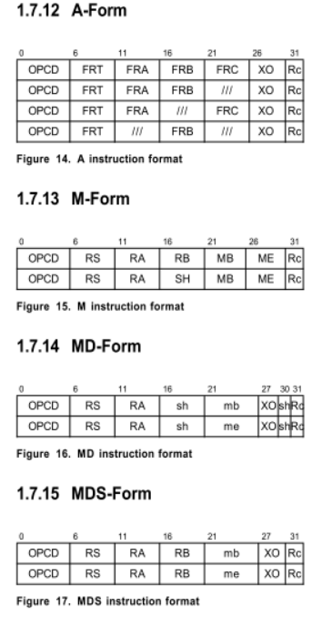
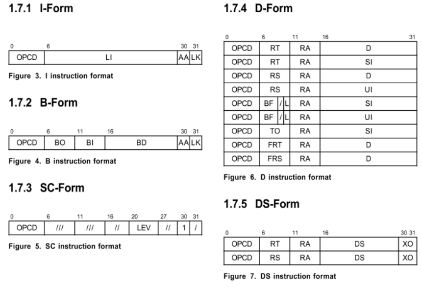
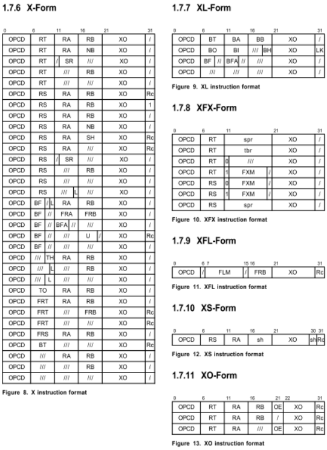

## 一、指令格式

### 1.1 字段描述
> 以下内容来自[【官方PowerPC指令集手册】](./ppc_isa.pdf)
1. **AA (30)**  
  Absolute Address bit.  
  0 The immediate field represents an address relative to the current instruction address. For I-form branches the effective address of the branch target is the sum of the LI field sign-extended to 64 bits and the address of the branch instruction. For B-form branches the effective address of the branch target is the sum of the BD field sign-extended to 64 bits and the address of the branch instruc-tion.  
  1 The immediate field represents an absolute address. For I-form branches the effective address of the branch target is the LI field sign-extended to 64 bits. For B-form branches the effective address of the branch target is the BD field sign-extended to 64 bits.    
2. **BA (11:15)**  
  Field used to specify a bit in the CR to be used as a source.    
3. **BB (16:20)**  
  Field used to specify a bit in the CR to be used as a source.  
4. **BD (16:29)**  
  Immediate field used to specify a 14-bit signed two's complement branch displacement which is concatenated on the right with 0b00 and sign-extended to 64 bits.  
5. **BF (6:8)**  
  Field used to specify one of the CR fields or one of the FPSCR fields to be used as a target.
6. **BFA (11:13)**  
  Field used to specify one of the CR fields or one of the FPSCR fields to be used as a source.
7. **BH (19:20)**  
  Field used to specify a hint in the Branch Condi-tional to Link Register and Branch Conditional to Count Register instructions. The encoding is described in Section 2.4.1, “Branch Instructions” on page 20.
8. **BI (11:15)**  
  Field used to specify a bit in the CR to be tested by a Branch Conditional instruction.
9. **BO (6:10)**  
  Field used to specify options for the Branch Con-ditional instructions. The encoding is described in Section 2.4.1, “Branch Instructions” on page 20.
10. **BT (6:10)**  
  Field used to specify a bit in the CR or in the FPSCR to be used as a target.  
11. **D (16:31)**  
  Immediate field used to specify a 16-bit signed two's complement integer which is sign-extended to 64 bits.
12. **DS (16:29)**  
  Immediate field used to specify a 14-bit signed two's complement integer which is concatenated on the right with 0b00 and sign-extended to 64 bits.
13. **FLM (7:14)**  
  Field mask used to identify the FPSCR fields that are to be updated by the mtfsf instruction.
14. **FRA (11:15)**  
  Field used to specify an FPR to be used as a source.
15. **FRB (16:20)**  
  Field used to specify an FPR to be used as a source.
16. **FRC (21:25)**  
  Field used to specify an FPR to be used as a source.
17. **FRS (6:10)**  
  Field used to specify an FPR to be used as a source.
18. **FRT (6:10)**  
  Field used to specify an FPR to be used as a target.
19. **FXM (12:19)**  
  Field mask used to identify the CR fields that are to be written by the mtcrf and mtocrf instructions, or read by the mfocrf instruction.
20. **L (10 or 15)**  
  Field used to specify whether a fixed-point Compare instruction is to compare 64-bit numbers or 32-bit numbers.  
  Field used by the Move To Machine State Register and TLB Invalidate Entry instructions (see Book III, PowerPC Operating Environment Archi-tecture).  
21. **L (9:10)**  
  Field used by the Synchronize instruction (see Book II, PowerPC Virtual Environment Architec-ture).
22. **LEV (20:26)**  
  Field used by the System Call instruction.
23. **LI (6:29)**  
  Immediate field used to specify a 24-bit signed two's complement integer which is concatenated on the right with 0b00 and sign-extended to 64 bits.
24. **LK (31)**   
  LINK bit.  
  0 Do not set the Link Register.  
  1 Set the Link Register. The address of the instruction following the Branch instruction is placed into the Link Register.  
25. **MB (21:25) and ME (26:30)**  
  Fields used in M-form instructions to specify a 64-bit mask consisting of 1-bits from bit MB+32 through bit ME+32 inclusive and 0-bits else-where, as described in Section 3.3.12, “Fixed-Point Rotate and Shift Instructions” on page 68.
26. **MB (21:26)**    
  Field used in MD-form and MDS-form instructions to specify the first 1-bit of a 64-bit mask, as described in Section 3.3.12, “Fixed-Point Rotate and Shift Instructions” on page 68.
27. **ME (21:26)**    
  Field used in MD-form and MDS-form instructions to specify the last 1-bit of a 64-bit mask, as described in Section 3.3.12, “Fixed-Point Rotate and Shift Instructions” on page 68.
28. **NB (16:20)**  
  Field used to specify the number of bytes to move in an immediate Move Assist instruction.
29. **OPCD (0:5)**  
  Primary opcode field.
30. **OE (21)**  
  Field used by XO-form instructions to enable setting OV and SO in the XER.
31. **RA (11:15)**  
  Field used to specify a GPR to be used as a source or as a target.
32. **RB (16:20)**  
  Field used to specify a GPR to be used as a source.
33. **Rc (31)**  
  RECORD bit.    
  0 Do not alter the Condition Register.    
  1 Set Condition Register Field 0 or Field 1 as described in Section 2.3.1, “Condition Register” on page 18.  
34. **RS (6:10)**  
  Field used to specify a GPR to be used as a source.   
35. **RT (6:10)**  
  Field used to specify a GPR to be used as a target.  
36. **SH (16:20, or 16:20 and 30)**  
  Field used to specify a shift amount.  
37. **SI (16:31)**  
  Immediate field used to specify a 16-bit signed integer.  
38. **SPR (11:20)**    
  Field used to specify a Special Purpose Register for the mtspr and mfspr instructions.  
39. **SR (12:15)**    
  Field used by the Segment Register Manipulation instructions(see Book III, PowerPC Operating Environment Architecture).
40. **TBR (11:20)**    
  Field used by the Move From Time Base instruc-tion (see Book II, PowerPC Virtual Environment Architecture).
41. **TH (9:10)**    
  Field used by the optional data stream variant of the dcbt instruction (see Book II, PowerPC Virtual Environment Architecture).
42. **TO (6:10)**    
  Field used to specify the conditions on which to trap. The encoding is described in Section 3.3.10, “Fixed-Point Trap Instructions” on page 60.
43. **U (16:19)**    
  Immediate field used as the data to be placed into a field in the FPSCR.
44. **UI (16:31)**    
  Immediate field used to specify a 16-bit unsigned integer.
45. **XO (21:29, 21:30, 22:30, 26:30, 27:29, 27:30, or 30:31)**    
  Extended opcode field.  

### 1.2 指令格式

> **Note:**   
A-Form = Floating ...  
Reserve = $(0..0)_{paddingSize}$
>

## 二、指令结构分析
### [2.1 PowerPC® Instructions](https://www.ibm.com/docs/en/aix/7.1?topic=reference-appendix-f-powerpc-instructions)  

